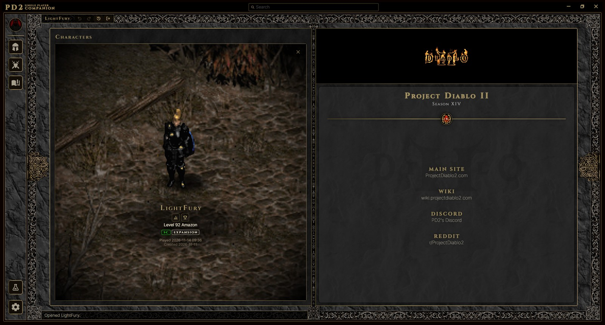
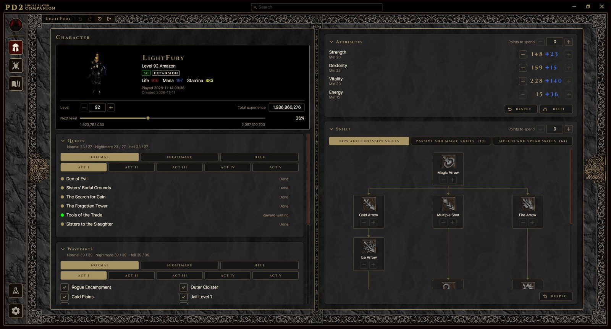
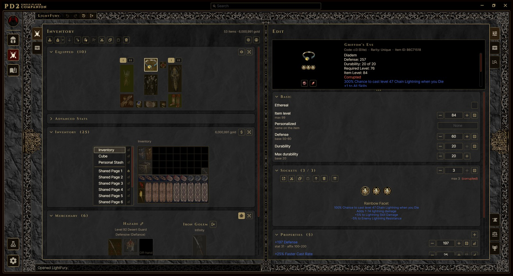
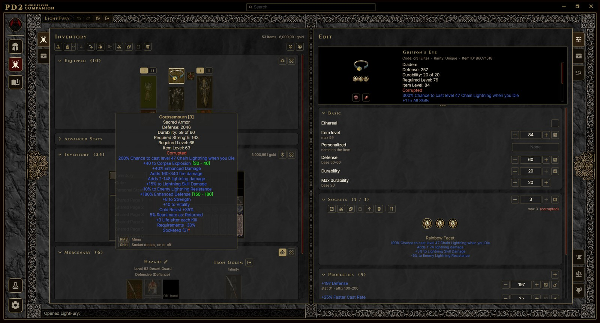
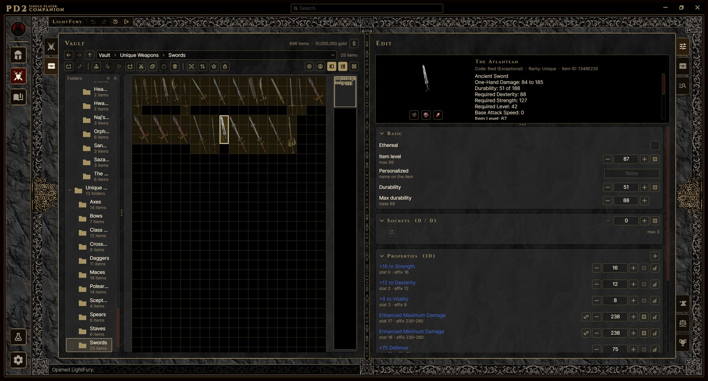
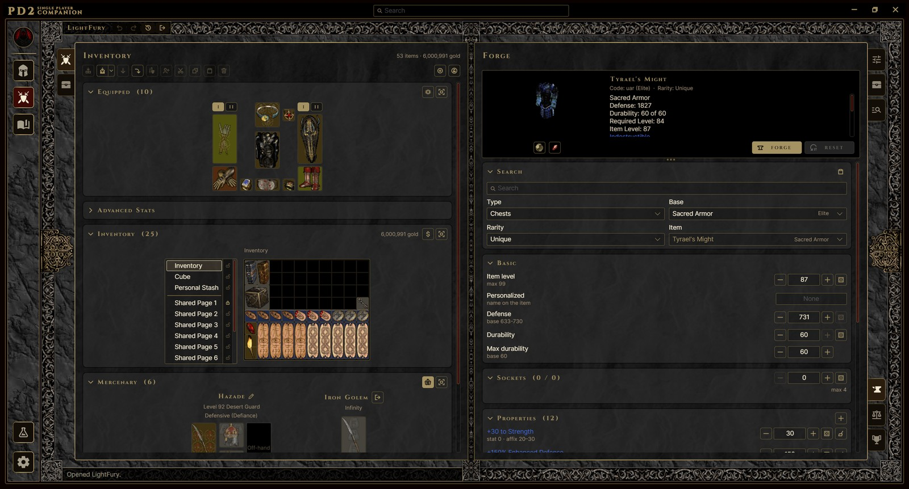
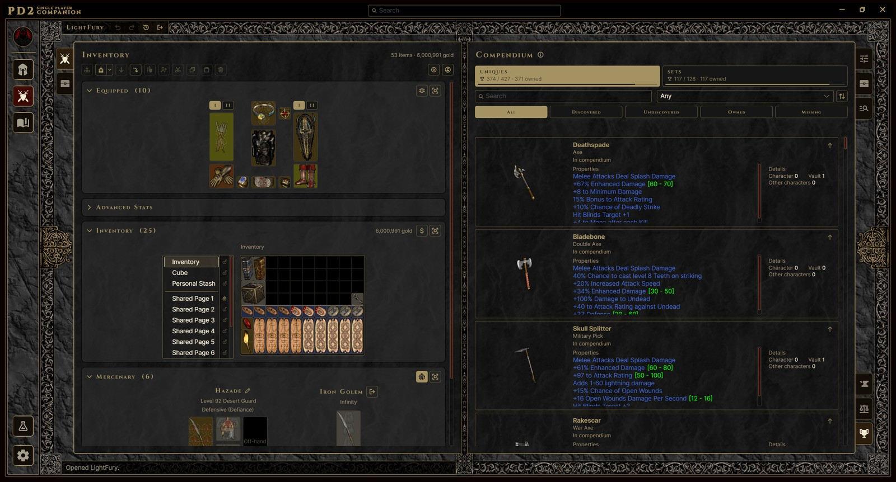
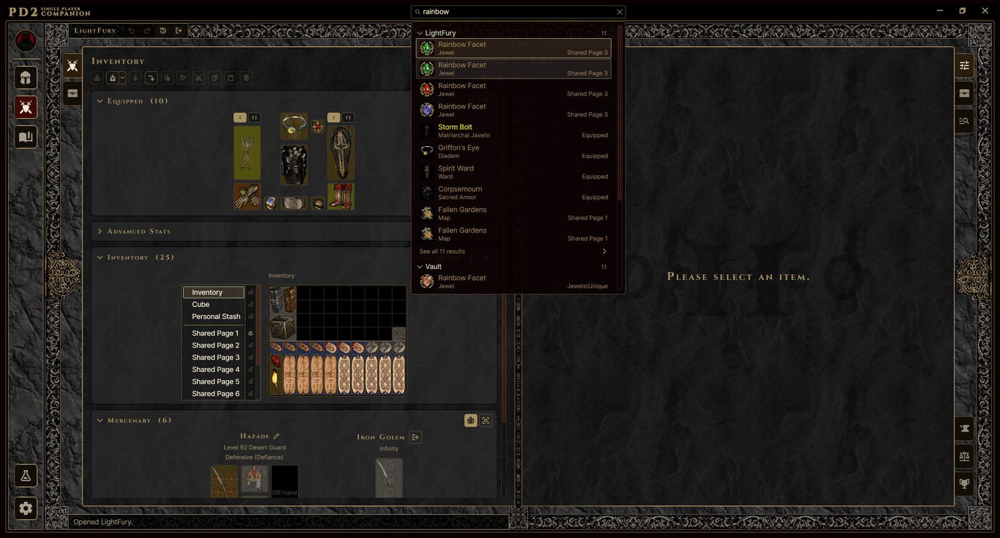

# Project Diablo II Single Player Companion

A character and item editor for [Project Diablo 2](https://wiki.projectdiablo2.com/wiki/Main_Page) single player:
open a character, change what you like, save, and play on. It reads the game's own tables and art from your
install, so items look and behave the way the game makes them.



> **Single player only.** PD2 online characters live on PD2's servers. Nothing about them exists locally, so
> nothing about them can be edited here.

Not affiliated with or endorsed by Blizzard Entertainment or the Project Diablo 2 team. Diablo is a trademark of
Blizzard Entertainment.

## Features

### Characters



- Level, experience, attributes and skills, with what the gear adds shown beside each attribute.
- Quests and waypoints for every difficulty and act; respec and refit.
- Create, clone, rename, delete and revive characters, or import one from the PD2 armory.
- The mercenary: its name, variant and level within its type, revived when dead, and its gear.
- Advanced Stats: the game's own page worked out from the gear, skills and auras.

### Items



- Edit anything on an item: affixes, properties, sockets, rare names, superior bonuses, automods, staff mods,
  ethereal, durability and item level.
- Every number shows the range the game rolls it in, and a die rolls it again with the game's odds.
- Corrupt, desecrate, craft, upgrade bases, reroll with the Demonic Cube and build runewords in place.
- Socketed jewels are edited where they lie.



### Inventory and shared stash

- Move items between the inventory, cube, stash, every shared stash page, the materials tab, the belt, the worn
  slots, the mercenary and a corpse.
- Drag several at once; cut, copy and paste; stacks join as in game.
- Sort and close gaps, and lock the pages you do not want touched.

### Vault



- Keep any number of items outside the game, in folders, and take them back to any character.
- Store sorted: rules written like PD2's loot filter put each item in its folder, crafting bases apart.
- Folder locks, quick access, vault gold, and a backup for each session that changed it.

### Forge



- Make any item from nothing: uniques, sets, runewords, magic and rare items, maps and materials.
- Rolled as a new drop, or set by hand within the game's ranges.
- Paste an item copied in game with Ctrl + C.

### Compendium



- Every unique, set piece and runeword, what the game has discovered, and the copies you hold.
- Store a copy in the game's Compendium or take one out.

### Search



- One search for the whole program (Ctrl + F): by name, base or stats, or a pattern, as the game's stash search
  takes them.
- Looks through the open character, the shared stash and the vault; the Home page's find box asks every
  character at once.

### And more

- **Play modes.** Legit, Casual and Free set how far an edit may go; Custom sets each rule by itself. A check marks
  any item the game could not have made.
- **Safety.** Autosave, undo and redo for the whole session, a backup before every write, and nothing written while
  the game runs or after a PD2 patch until your saves check out.
- **Seasons.** A PD2 patch needs no update here: the tables are read from your install, each season's are kept, and
  characters and vaults can be migrated.
- **Virtual trading.** Buy and sell from PD2 trade listings at your own prices, with a record of every trade.
- **Extras.** A rune wizard, a crafting wizard, drop rates and monster density for testing, UI scale, keyboard
  shortcuts on one sheet (F1) and language packs.

[CHANGELOG.md](CHANGELOG.md) lists every release.

## Getting started

1. Download the zip from [Releases](../../releases), unzip it anywhere and run `PD2SPCompanion.exe`.
   It needs 64-bit Windows and Project Diablo 2 installed.
2. On the first start it asks where the game is.
3. Close the game before saving: nothing is written while it runs.

Everything the program keeps - settings, the vault, backups, logs - is in the `Data` folder beside the exe. Every
save is backed up before it is written, and every write is read back and refused if it does not match.

## License and credits

The code is under the [MIT License](LICENSE). The icon and logo are not: they may be passed on only with the program,
as they are. Other people's work in the program keeps its own license; see
[THIRD-PARTY-NOTICES.md](THIRD-PARTY-NOTICES.md).

Icon created with Grok.

## Why it reads your install

Item properties are a bitstream of stat ids whose field widths come from
`ItemStatCost.txt`. PD2 changes that table every season — 159 save-encoding changes
between S8 and 12.0.6b alone. Parsing with a stale copy does not throw; it silently
returns wrong values.

That table is also why current PD2 uses **10-bit** item stat ids where every public
parser assumes 9: PD2 has filled all 511 rows of the 9-bit id space, so the field had
to widen.

So the companion ships no game data. It opens the archive chain in the game's own
override order and reads the tables live, which means a PD2 patch needs no release here.

## What survives a PD2 patch

Read from your install at launch, so a seasonal patch needs no release here:

- every item/affix/stat table, and any change to a field's width or offset within them
- new items, uniques, sets, runewords, affixes, stats and skills
- item art, including graphics added this season
- container sizes — grids grow to fit what the character actually has

Hardcoded, because it is not described by any table, and would need a code change:

- the 10-bit item stat id width, and the 9-bit width used by character attributes
- the 3 bytes PD2 reserves ahead of the item list for its extra skills
- the item bitstream's field order, and the grouped min/max damage stat ids

If a future patch does change the structure, **the tool refuses to open the file rather
than mangling it**: loading requires a byte-identical round-trip, so a layout change
fails that check and reports a refusal. The PD2 trailer is copied verbatim, so changes
to it — including its length — pass through untouched.

## Command-line tool

`pd2spc help` lists every command by group, and `pd2spc help <command>` gives one's usage. Exit codes
are 0 clean, 1 a finding or refusal, 2 wrong usage. Some of the most used:

Reading the install and the tables:

```
pd2spc info                          # archive chain + every table it resolves
pd2spc extract --out <dir>           # write the excel tables to disk
pd2spc statdiff <old> <new>          # compare two ItemStatCost tables
pd2spc itemcode <code>               # what a base code is, and what may go on it
pd2spc props                         # audit every property that writes more than one field
pd2spc stats [--out <file>]          # the stat catalogue
pd2spc sprite <name>                 # resolve an item sprite out of the archives
```

Reading a save:

```
pd2spc dump <save.d2s>               # a character: attributes, every item, every range
pd2spc dump <stash.sss|.d2x> [--page <name>]
                                    # a stash, page by page
pd2spc ranges <save.d2s>             # what each stat could have rolled
pd2spc affix <save.d2s>              # the affixes each item carries
pd2spc verify <save.d2s>             # parse, re-serialize, byte-compare
pd2spc legit <save.d2s>              # what the game would not have produced
```

Changing a save (each backs up first and refuses a write it cannot justify):

```
pd2spc set <save.d2s> --item <n> --stat <name> --value <v> [--dry-run]
pd2spc addstat <save.d2s>            # add a property the item's sources allow
pd2spc corrupt <save.d2s>            # apply a corruption
pd2spc reroll <save.d2s>             # roll an item's properties again
pd2spc craft <save.d2s> --item <n> [--family <name>]
                                    # craft a copy in memory and print what it kept; writes nothing
pd2spc migratefiles --from <dir> <save.d2s> [--out <dir>]
                                    # carry items forward from another season's tables
pd2spc density <n>                   # the monster-density override
```

A command that reads the game takes `--game <dir>`, else the variable `PD2SPC_GAME`; with neither it stops with its usage.

`verify`, `legit` and `migrate` also take:

| flag | what it does |
| --- | --- |
| `--corpus <dir>` | walk a folder of saves and stashes (`.d2s`, `.sss`, `.d2x`) instead of one file |
| `--tables <dir>` | read a folder of loose `.txt` tables ahead of the archives, the way the game's `-direct` does — **this is how an older season's items get read with the tables they were made under**, and without it most of them are refused |
| `--top <n>` | `legit` only: how many finding shapes to print (default 40). Raise it to diff two runs; the default hides the tail, which is where a change usually shows |
| `--trace` | the whole exception, not just its message |

## Running the checks

| Level | What it needs |
| --- | --- |
| `python tests/check.py quick --no-game` | .NET 10 and Python. Builds, runs the tests that need no game and the static checks, and says what it left out. |
| `python tests/check.py quick` | Also PD2 installed (`PD2SPC_GAME`), the test corpus (`PD2SPC_CORPUS`) and Season 13's tables (`PD2SPC_S13_TABLES`). Stops at once without them, and fails on any test skipped. |
| `python tests/check.py changed`, `full`; `tests/regress.py` | The same three. Longer. |
| `tests/ui/run.ps1` | The same, on Windows. It takes the mouse and keyboard. `-List` needs nothing and opens no window. |
| `dotnet test` | The same three. Without them most tests are Skipped and one fails, saying what is missing. |

The corpus holds real saves and is not in this repo, so a clone runs `--no-game`. Each location is a variable, or a line
`NAME=value` in a file `pd2spc.local.env` in the repo's folder or above it (never committed).

## Layout

```
src/PD2SPCompanion.D2S/            the save parser (vendored D2SLib, PD2-aware)
src/PD2SPCompanion.Core/           by domain, inner to outer (a layer uses only those above it):
                              Mpq/, Graphics/, GameFiles/  the archives, sprites, tables, strings
                              Items/        what an item is: affixes, stats, ranges, legitimacy;
                                            Items/Crafting/ the cube, corruption, crafts, the forge
                              Saves/        the file formats and writing them safely
                              Characters/   class, levels, skills, quests, placement, creation
                              Collection/   the vault, the grail, smart sort, season migration
                              Trade/        the market and the armory
                              Testbed/      the Experimental page's game-folder overrides
                              Season.cs, SaveTables.cs  the composition root: opens a season
src/PD2SPCompanion.Shell/          the Avalonia UI: views, view models, application services
src/PD2SPCompanion.Shell.Desktop/  the exe
src/PD2SPCompanion.Cli/            pd2spc: Cli.cs (registry, help) + Commands/<group>.cs
tests/regress.py              regression tiers over the test corpus (PD2SPC_CORPUS)
tests/ui/                     UI Automation tests (see tests/ui/README.md)
```

Dependencies point inward: D2S <- Core <- Shell <- Desktop, and Core <- Cli. Core knows no UI.

Build: .NET 10. `dotnet build`.

## See also

- [krisives/d2s-format](https://github.com/krisives/d2s-format) — save format spec
- [BetweenWalls/PD2-Converter](https://github.com/BetweenWalls/PD2-Converter) — PD2-aware D2SLib fork
